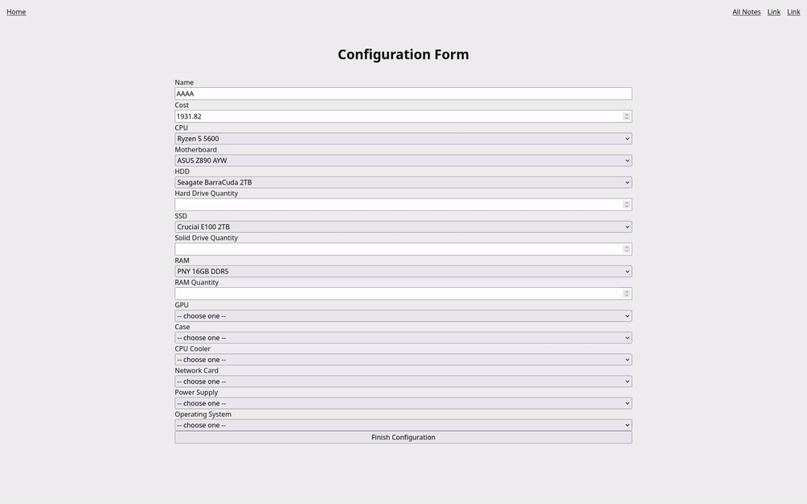
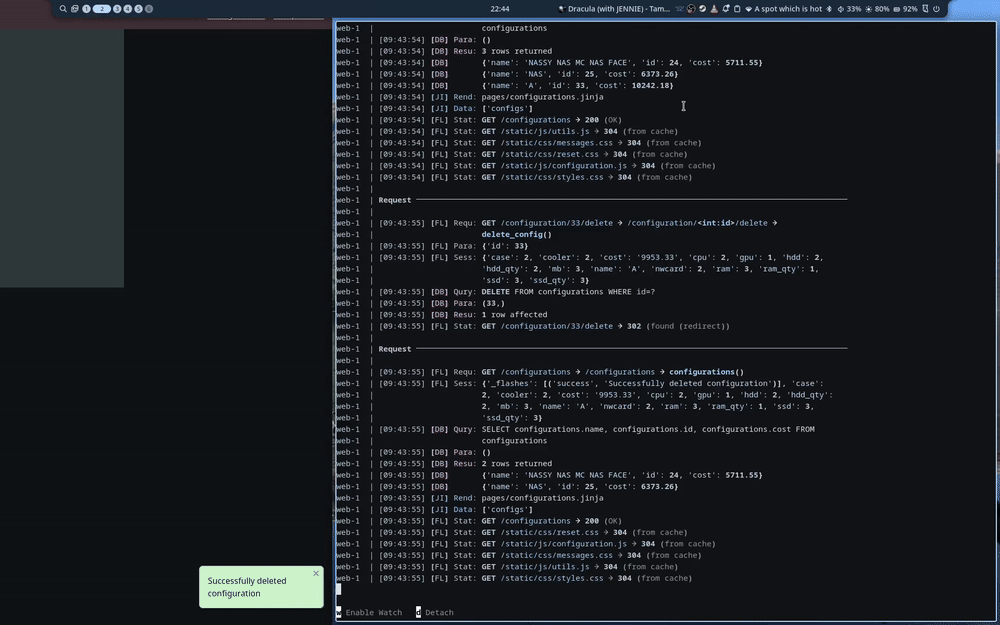
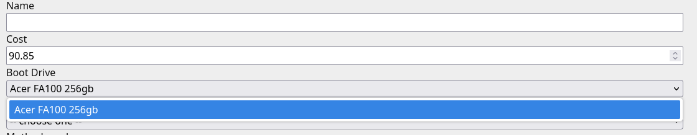
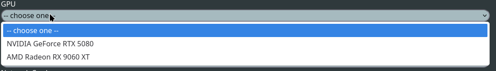
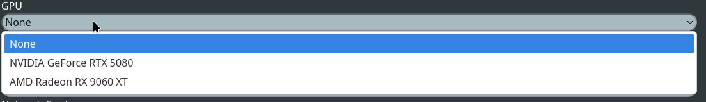
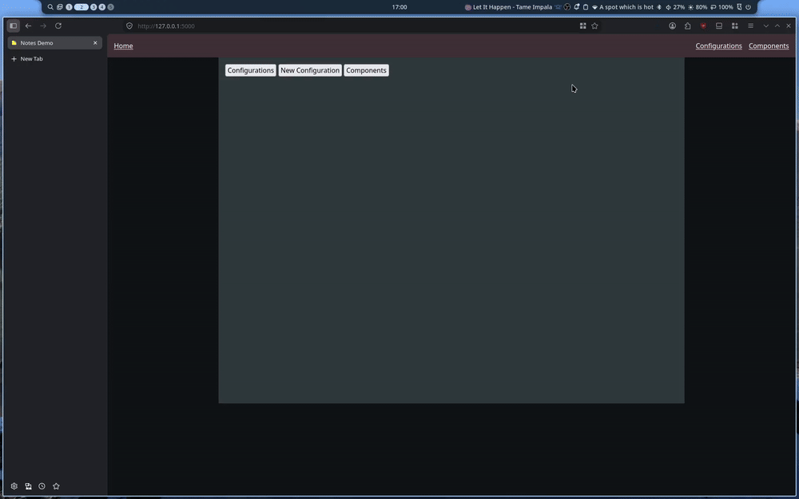
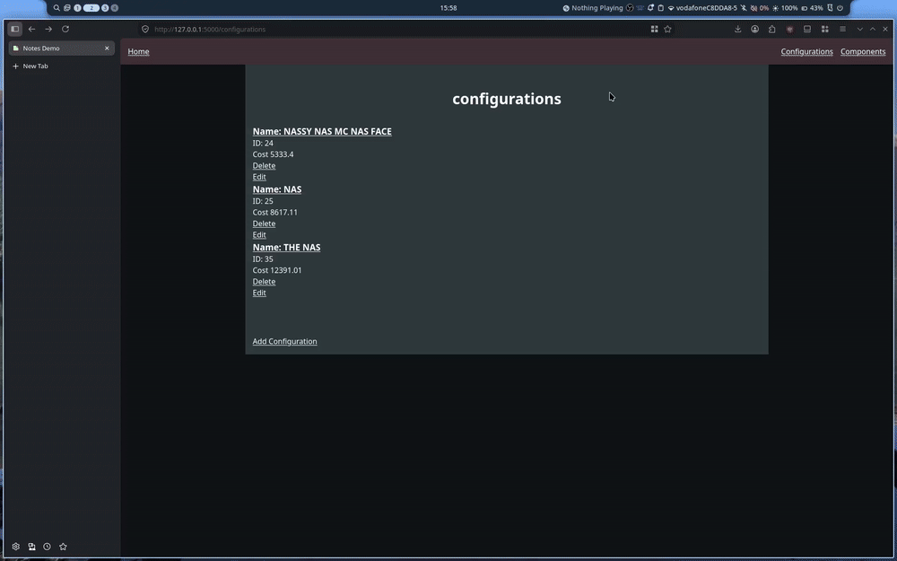
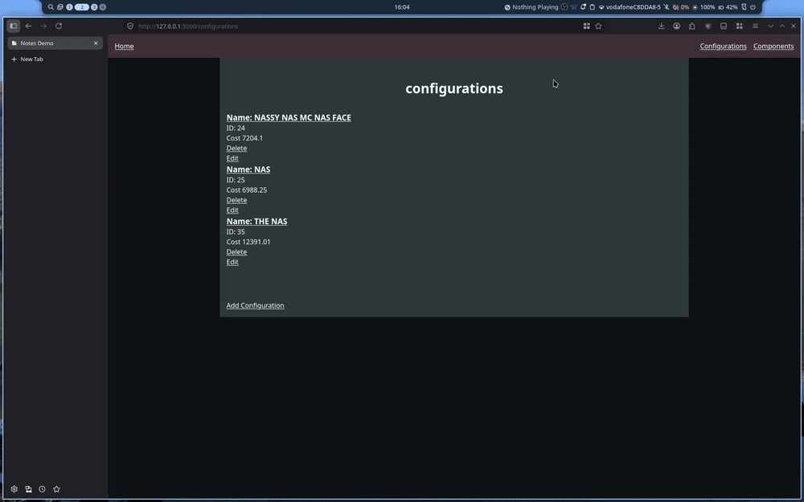
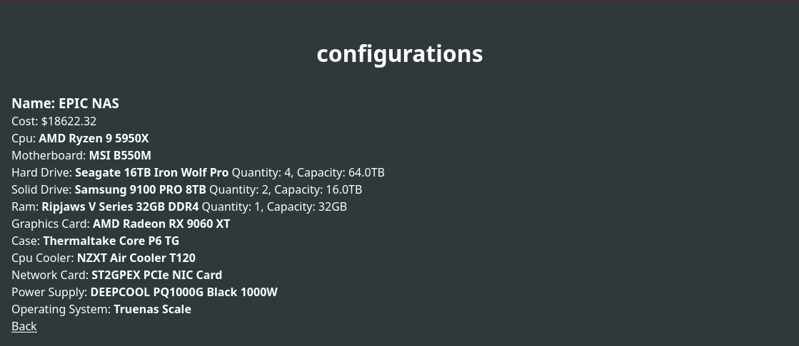
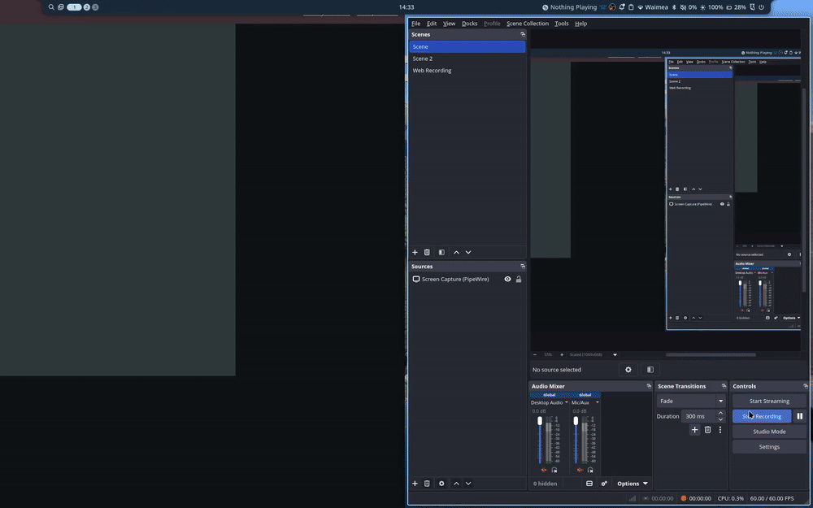

# Sprint 3 - Developing a Minimum Viable Product (MVP)

## Sprint Goals

Continue to develop the web application to the point that it provides all key functionality of the system. Test and refine it so that it can serve as the basis for the final phase of development.

### Specific Goals

**Edit these goals as needed**

- Create the following web pages:
    - Form for creating configurations which have compatable parts and accurate pricing.
    - Fully functional components page
    - Fully functional configurations page
    - All links working
- Develop SQL database queries to:
    - Same as sprint-2 (already done)
- Adding some colour as shown by ui prototyping to improve UX.
- Make overall theming close to that of the mock ups
- Make default mandatory boot drive rather than being part of solid drives
- General tidy up of some messy leftover parts.
- Tidy up codebase

## Testing price calculating

This is the initial price calculation which as shown in the video does not work with multiple of the same component

### Changes / Improvements
I have fixed the price calculation (this is the same gif used later in docu)

## Testing mandatory boot drive

I have now added a mandatory boot drive when making the NAS, this works and is incorperated into the price

## Testing selection options for GPU & other optional items

This is the initial testing for this style of item

### Changes / Improvements

After talking with my stakeholder we decided that for optional items instead of displaying -- Choose Me -- it should display None as it is more clear that this is an optional component

# Important pivot point

After discussing with my stakeholder and by attempting at methods of validiation, this current from style is not maintanable, i will be moving to a sessions based style for my component picking, which is step by step. I will be building my project with this is mind to still meet all of my other requirements of my stakeholder to make sure that the final product remains satisfactory.

By doing my project this way it will properly allow me to ensure that all components are compatable with each other.

## Testing new config form

This is the initial test of my new config form, as shown by the GIF when the final stage of the form is initialised the price in relatiotion to quantity items does not transfer. This form now is ajusted based off the selected motherboard to ensure that all components are valud

### Changes / Improvements

I have now fixed the issue related to quanitity items as well as fixes bugs related to some other components, the submission for a new config is now fully functional

"The new desgin still meets the requirements, because you start off with a motherboard and then can only select compatable components assosiated with that motherboard. Still nicely contained mostly in one menu." -Gareth 24/09/2026

## Testing editing configurations

This is my initial testing of my configuration editing, as shown by the video the name on the flash notification does not display correctly

### Changes / Improvements

As shown by this gif I have fixed the issue regarding the flash notification as well as not allowing mandatory options to be set back to the "-- choose one --" option

## Testing Showing total capacity & quantity

My config viewing now shows all the capacity of hdd and ssd/ram

## Testing that all links work
As shown by the gif all links work without problem

## Sprint Review

This sprint has taken a long time to get done but I have now met all my requirements for my MVP, including fully functional configuration adding with logic based off the motherboard/components to ensure a compatable build. I have made some UI impovements to get it closeish to that of the mock ups. My configurations have accurate pricing and can be edited while staying fully compatable. You are also able to view the total storage of the different storage mediums in the configuration. I now predominatly have UI and UX changes left to make in sprint 4, but am otherwise complete.

"This sprint has producesd a highly functional model which addresses all the requirements captured.  The end result is a higly functional web application that includes logic to ensure that only compatable parts are selected, the menu" is easy to navigate, the links to PBTech are a great touch that provides full information and reviewson the selected products." -Gareth 13/10/2026