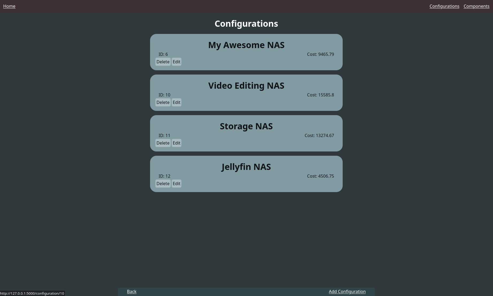
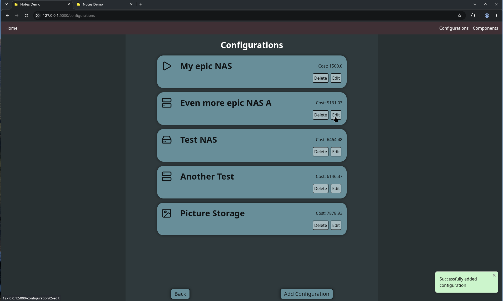
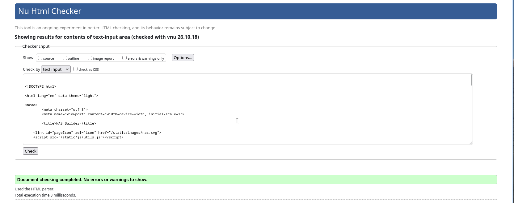
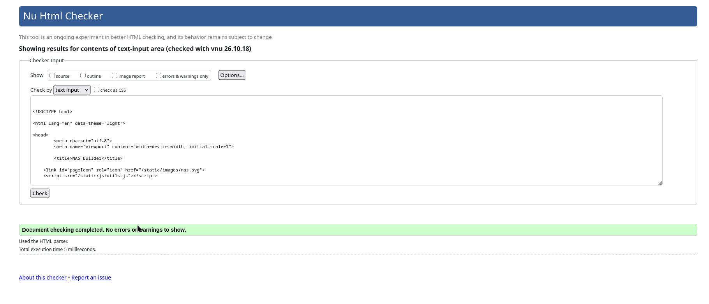
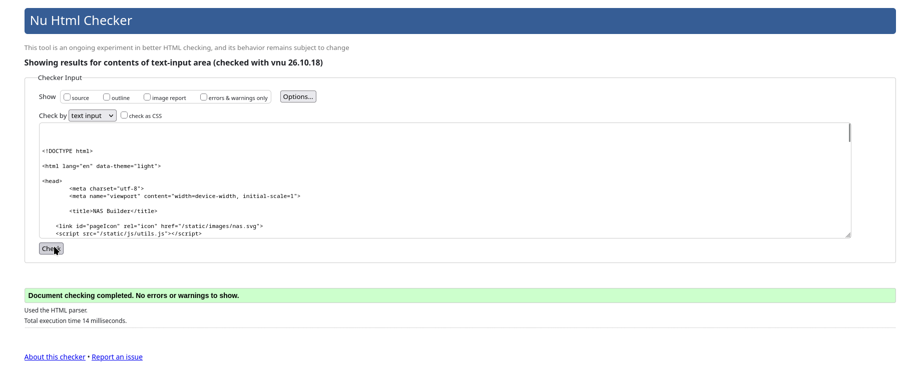
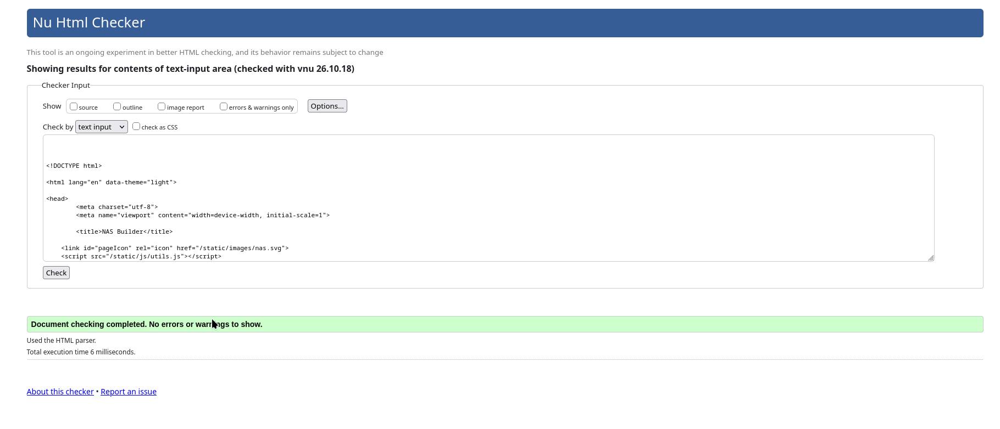

# Sprint 4 - Developing a Refined and Complete System

## Sprint Goals

Develop the system until it is fully featured, with a refined UI and it satisfies the requirements. The system will be fully tested at this point.

### Specific Goals

**Edit these goals as needed**

- Refining naming of components
- Refine the design and UI of the website
- Refine the user experience (UX) of the system
- Perform final, full-system testing
- Add descriptions for motherboards regarding what they entale
- Add icons for configurations

## Testing Configuration page

My orignal page for configurations at the start of the print

### Changes / Improvements 1

I have changed the background to match across the whole page based on my stakeholders feedback

### Changes / Improvements 2

My stakeholder commented on the requirement for better contrast as well as improving the astetic of the new configuration and back buttons, this has been done in this improvment.

### Changes / Improvements 3

I have implemented icons to my configurations allowing the user to more easily and vissualy destinguish between their configurations

### Changes / Improvements 4 

I have improved the layout of the icon as well as switching the edit and delete names for icons making a simpler and clearer design.

## Testing Updated Homepage

This is a screenshot of my new homepage which now has properly styled buttons

<!-- ### Changes / Improvements

Replace this text with notes any improvements you made as a result of the testing.

**PLACE SCREENSHOTS AND/OR ANIMATED GIFS OF THE IMPROVED SYSTEM HERE** -->

## Testing FEATURE NAME HERE

Replace this text with notes about what you are testing, how you tested it, and the outcome of the testing

**PLACE SCREENSHOTS AND/OR ANIMATED GIFS OF THE TESTING HERE**

### Changes / Improvements

Replace this text with notes any improvements you made as a result of the testing.

**PLACE SCREENSHOTS AND/OR ANIMATED GIFS OF THE IMPROVED SYSTEM HERE**

## ETC...

## Proof for HTML & CSS validation

### CSS (styles.css)

### HTML - Homepage (homepage.jinja)

### HTML - Components Page (components.jinja)

### HTML - Configurations Page (configurations.jinja)

### HTML - Configuration Page (configuration.jinja)

### HTML - New Config Page - 1 (select_motherboard.jinja)

### HTML - New Config Page - 2 (new_configuration.jinja)

### HTML - New Config Page - 3 (new_configuration.jinja)

### HTML - Edit Config Page - 1 (select_motherboard.jinja)

### HTML - Edot Config Page - 2 (new_configuration.jinja)

### Python PEP8 Validation

All runtime errors are not ture problems but rather related to the way that the project is setup as they are pulled externally, none of my actual code has any runtime errors within it.

Whilst there are many styling errors in my code I belive that they are not relevent as fixing most of them will result in worse readability of the project, I have stuck to PEP8 convention where it makes sense to do so but not at the cost of readability.
## Sprint Review

Replace this text with a statement about how the sprint has moved the project forward - key success point, any things that didn't go so well, etc.

