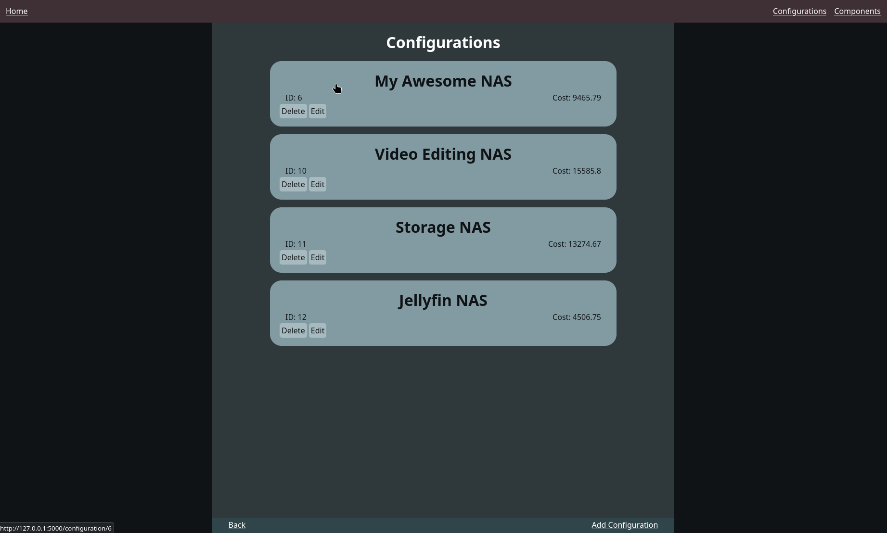
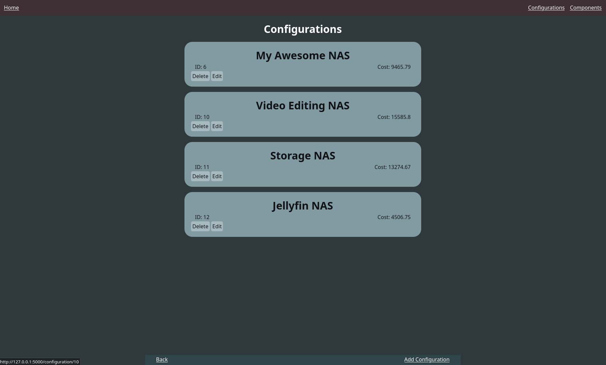
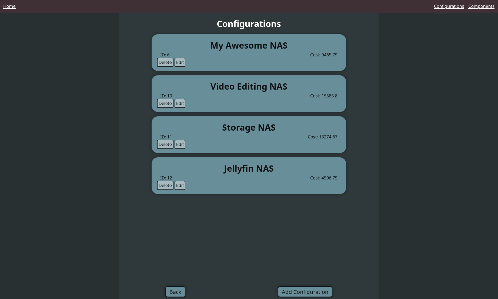
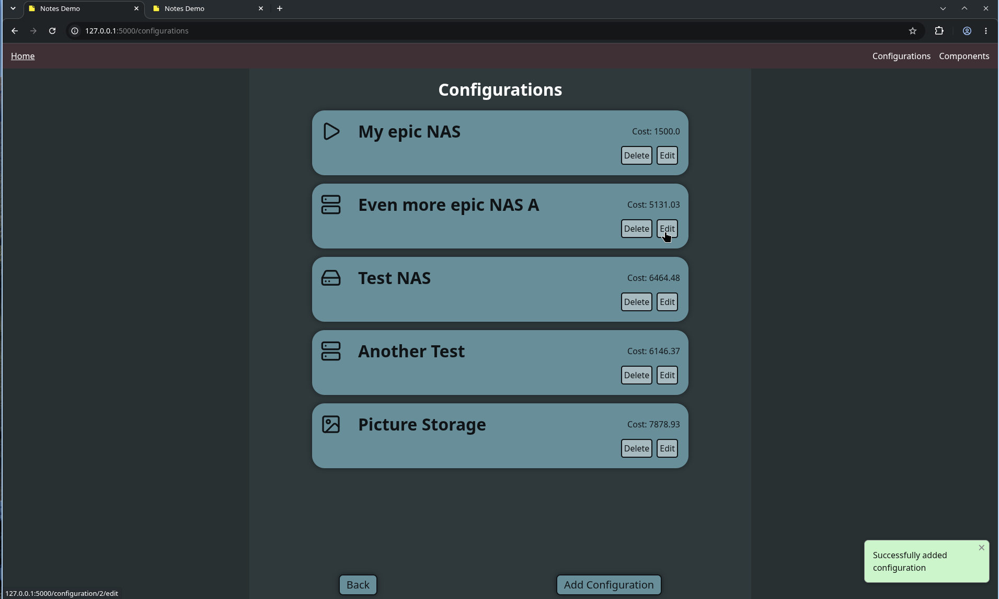
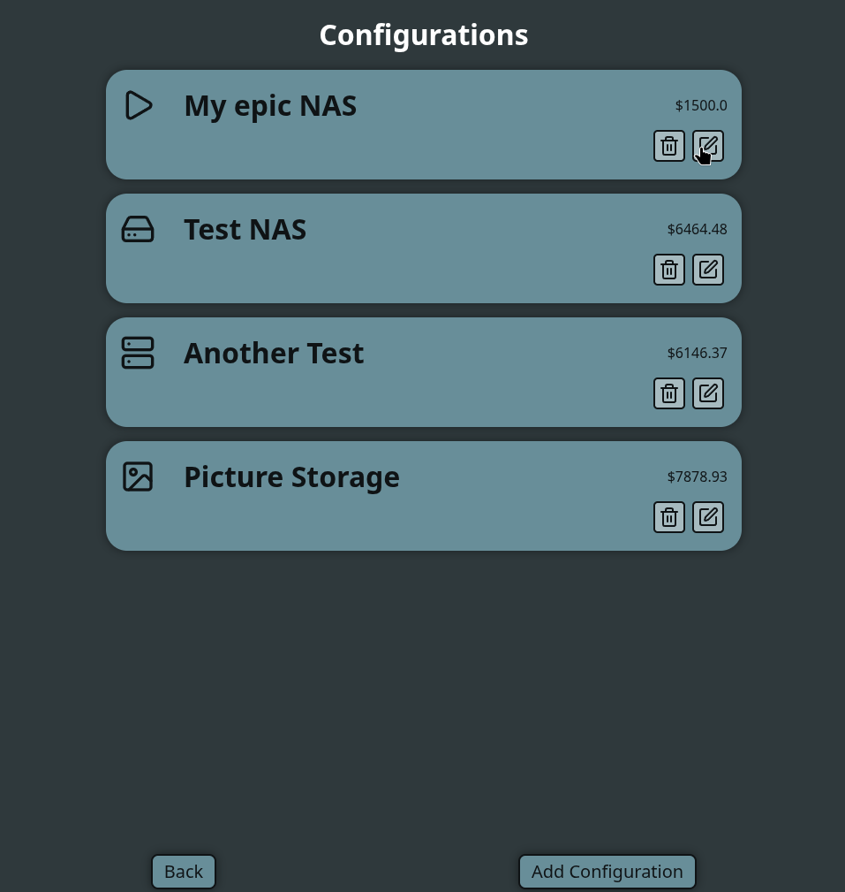
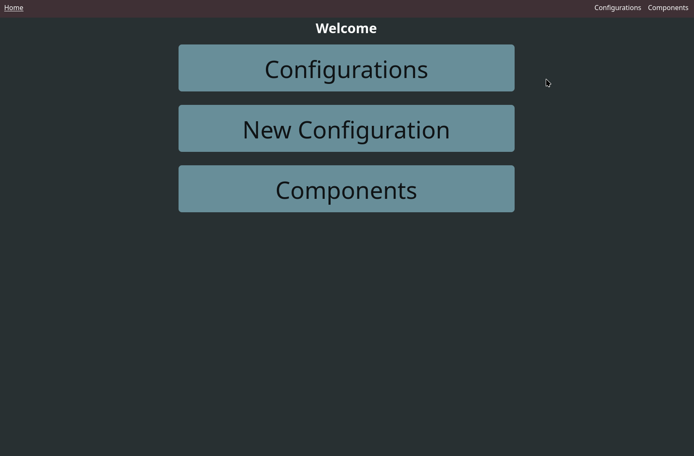

# Sprint 4 - Developing a Refined and Complete System

## Sprint Goals

Develop the system until it is fully featured, with a refined UI and it satisfies the requirements. The system will be fully tested at this point.

### Specific Goals

**Edit these goals as needed**

- Refining naming of components
- Refine the design and UI of the website
- Refine the user experience (UX) of the system
- Perform final, full-system testing
- Add descriptions for motherboards regarding what they entale
- Add icons for configurations

## Testing Configuration page

My orignal page for configurations at the start of the print

### Changes / Improvements 1

I have changed the background to match across the whole page based on my stakeholders feedback

### Changes / Improvements 2

My stakeholder commented on the requirement for better contrast as well as improving the astetic of the new configuration and back buttons, this has been done in this improvment.

### Changes / Improvements 3

I have implemented icons to my configurations allowing the user to more easily and vissualy destinguish between their configurations

### Changes / Improvements 4 

I have improved the layout of the icon as well as switching the edit and delete names for icons making a simpler and clearer design.

## Testing Updated Homepage

This is a screenshot of my new homepage which now has properly styled buttons

<!-- ### Changes / Improvements

Replace this text with notes any improvements you made as a result of the testing.

**PLACE SCREENSHOTS AND/OR ANIMATED GIFS OF THE IMPROVED SYSTEM HERE** -->

## Testing FEATURE NAME HERE

Replace this text with notes about what you are testing, how you tested it, and the outcome of the testing

**PLACE SCREENSHOTS AND/OR ANIMATED GIFS OF THE TESTING HERE**

### Changes / Improvements

Replace this text with notes any improvements you made as a result of the testing.

**PLACE SCREENSHOTS AND/OR ANIMATED GIFS OF THE IMPROVED SYSTEM HERE**

## ETC...

## Sprint Review

Replace this text with a statement about how the sprint has moved the project forward - key success point, any things that didn't go so well, etc.

