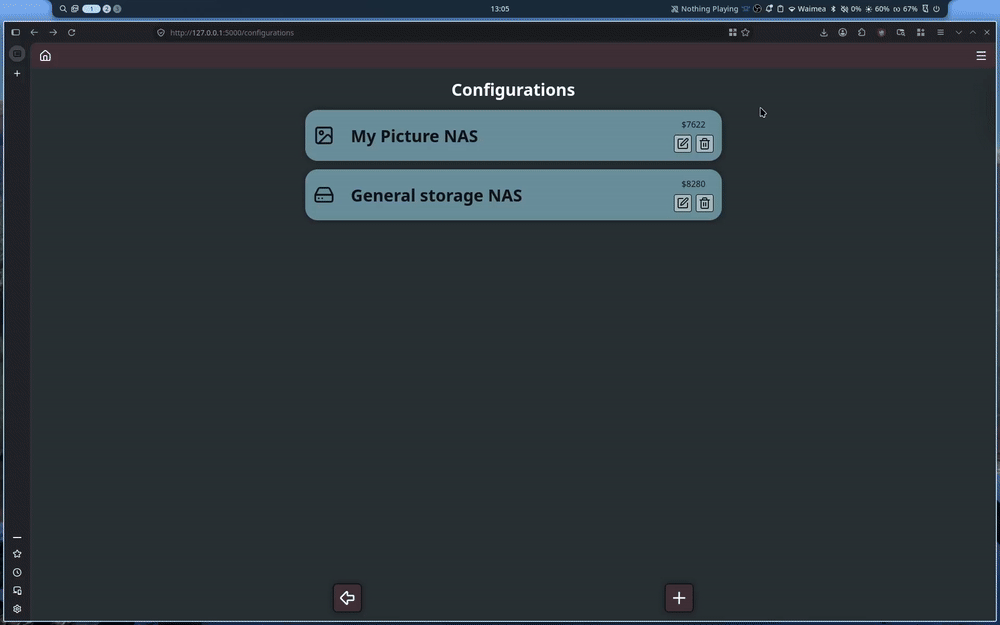
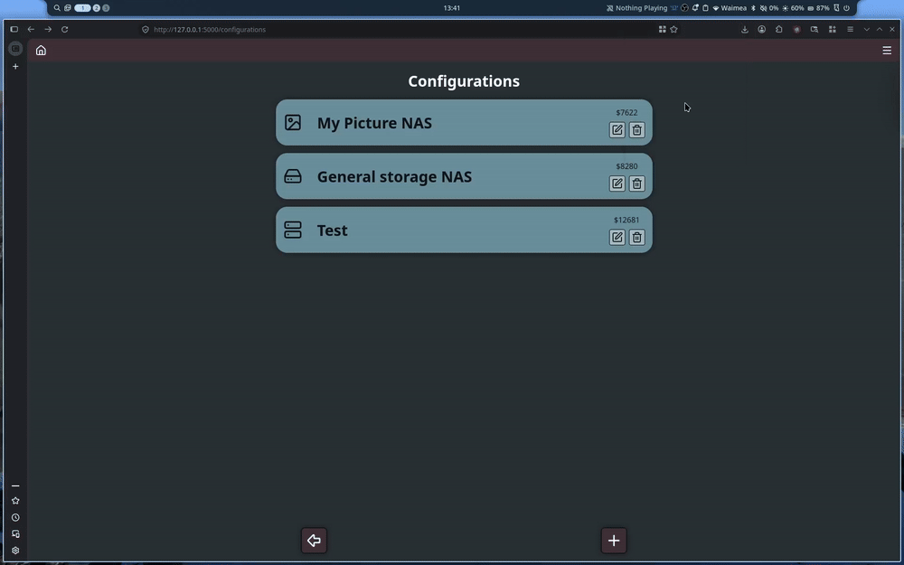
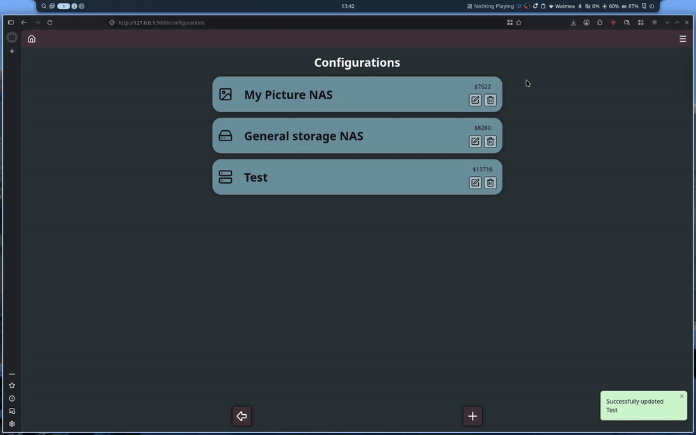
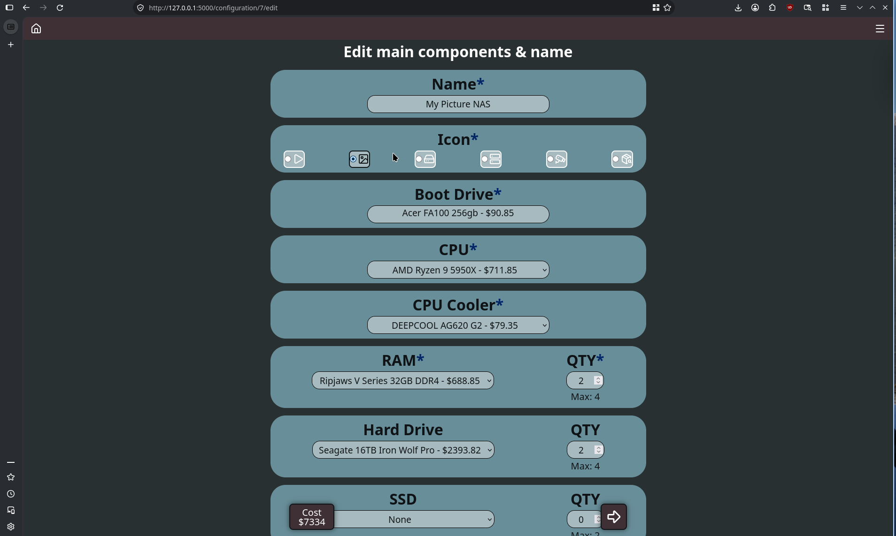
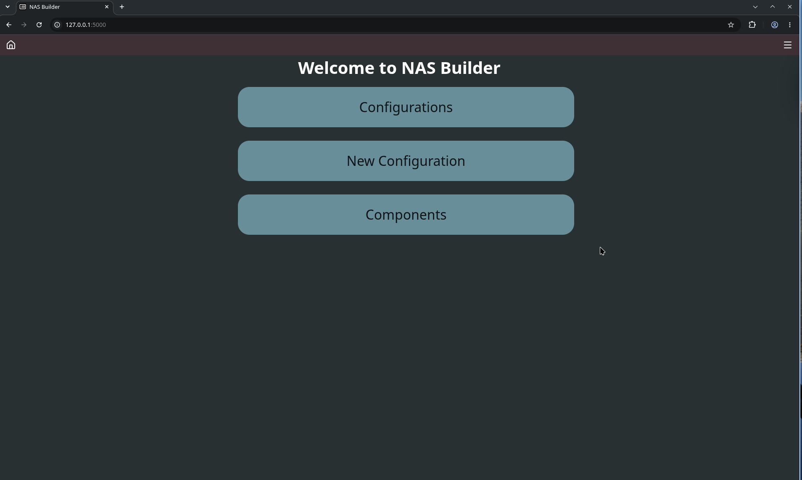
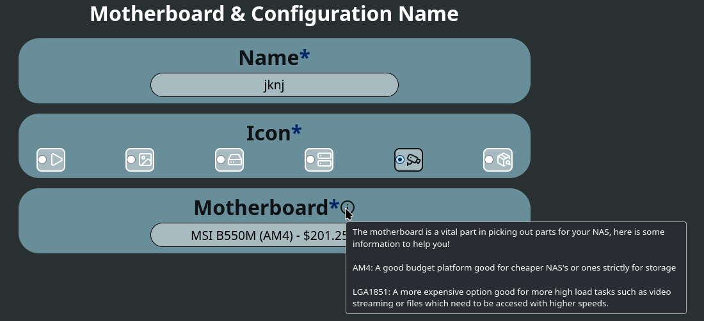
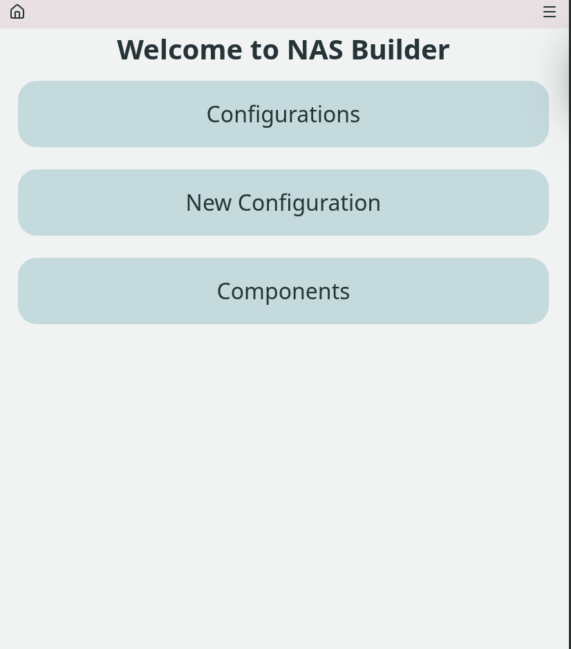
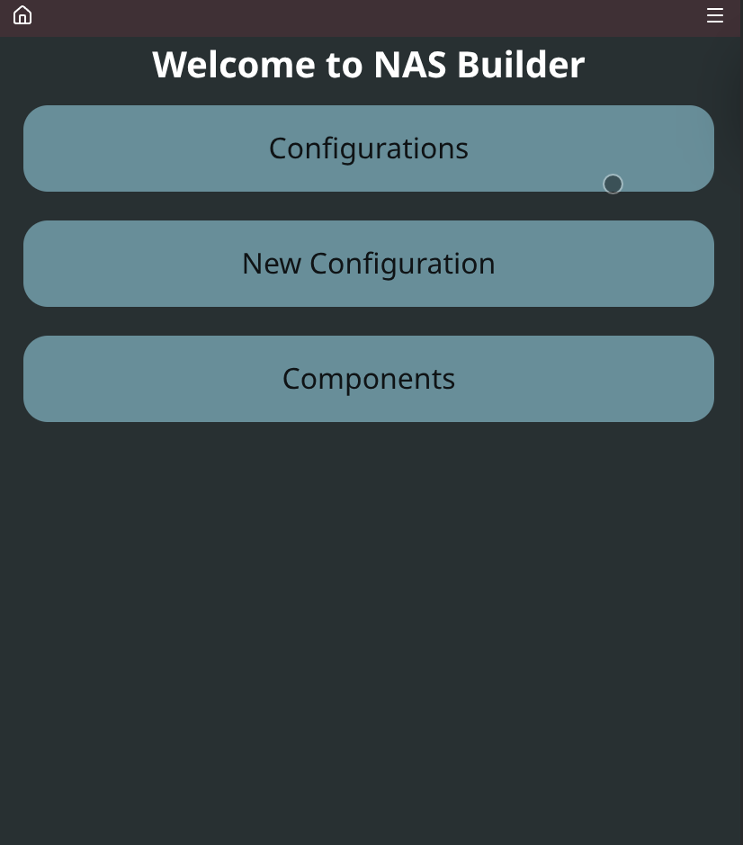
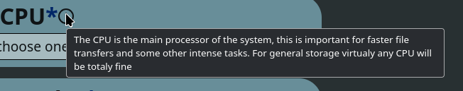
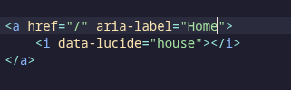

# Project Final Review and Reflection

## Addressing Relevant Implications

### Functionality

I have done through testing throughout the project to ensure that all builds are compatable by basing component options off the other users options. I have done rigerous testing as shown by my other sprints to ensure using my sight is a bugless and smooth experince.

#### GIF of testing for forms (showing valid, invalid, boundary)

#### GIF of editing forms (showing valid, invalid, boundary)

#### GIF showing config deleting

Refer to previous sprint for footage on ipad.

#### GIF working on firefox & chrome

Firefox

Chrome

#### Recomendations based off usecase

I have met my functionaility implications by doing proper testing, and ensuring that a user can only build a compatable build ina bugless and smooth way. The user is able to save, delete and edit their configuration. The user can view their total storage on the menu for the individual configuration and select their desierd software.

### End-user

I have met my end user implications well by keeping my website simple while still being powerfull and not over the top on assitive features. There is explantation surrounding more complicated things such as motherboards for the user to base their choices off of giving them a good sense of direction without feeling like im telling them what to do. I have implemented proper navigation for keyboard so that impared users are able to use the website as well as providing both a light and dark more for the website as some may find one easier to use than the other. 

I have shown that my website is usable on a variety of devices throuout my previous sprints meeting this requiremnt.

#### Light mode

#### Dark mode

### Usability

I have met my usability implications well by ensuring I have kept the design of my website simple and minimilistic, using as little text as possible and rather using recognizable icons to provide the user a link to the real world and alow them to more easilty use my website. I have provided information via tooltips on any component which is more complicated to allow this tool to be avalible to less experinced users, examples provided below.

#### Motherboard Tootltip

#### CPU Tooltip

I have provided proper navigation for those who use keyboard navigation as well as ensuring my icons can work on screen readers using aria-label, this means that a variety of users even those with imparment are able to use my website

#### Aria label

#### Navigation

I have shown User Control and freedom as users are free to go back and edit their changes later as shown in previous sections.
I have shown help and documentation via the tooltips on the form options.
I have shown match between system and real world by the through use of relatible icons to the user.

### Accessibility

I have produced UI with a good colour contrast both in dark and light mode, likely with slightly better contrast in light mode. This allows morse users to use my site as colourblindness should not affect the usability of my website. There is labels/alt text where required for those using screen readers allowing users with full vision imparement to comfortably use my site.

My website is usable on all of my target devices (prodomintly desktop and tablet) as well as working acceptably on mobile tough being optimised for the other platforms.

I have used logical input fields so that users of any skill level should not be overwhelmed using my website.
I have made sure that my website is fully navigatable by keyboard with and a keyboard reader, this means that all users will be able to use my website.

### Privacy

My site does not collect any peronsally identifyiable information making it saftey concious for users. Users are also able to remove builds from the database simply through the UI meaning that if for some reason a user does no longer wish for their build info to be avalible it can be simply removed.

## Overall Review

#### What went well?
I am mostly happy with the end product and I have kept up good communitcation with my stakeholder the whole time ensuring a product that my stakeholder is also happy with

#### What didn't go so well?
I majorly understimated the complexity of my project leading it to taking far longer than i would have imagined and putting alot of pressure on the end of the project

#### How did the testing/trialling impact the final system?
The trialling and testing had a large part on the final system. I fully redesigned the way that I did my forms so that they were multi page while continuing to communitcate with my stakeholder ensuring they are happpy with the changes. I have tried to stick as best as possible where applicable to the design specifications.

#### What would you do differently if you could?
I would like to manage my time better getting done with the logic earlier so that I am able to focus on my front end in a better manor being able to fufill some of my specs a little bit better.

## Final stakeholder comment
"You have shown great commitment, this was a far bigger task than you could have imagined in the beginning.  The constant refinements and attention to detail has made this a great success.
All the initial requirements have been ticked off and you have listened to feedback throughout and incorporated it in each sprint.
The end product is very functional and works well on both platforms I have tested it on(IPad and PC)
Great work" -Gareth
